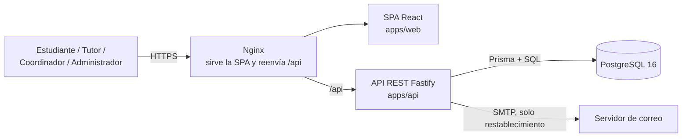
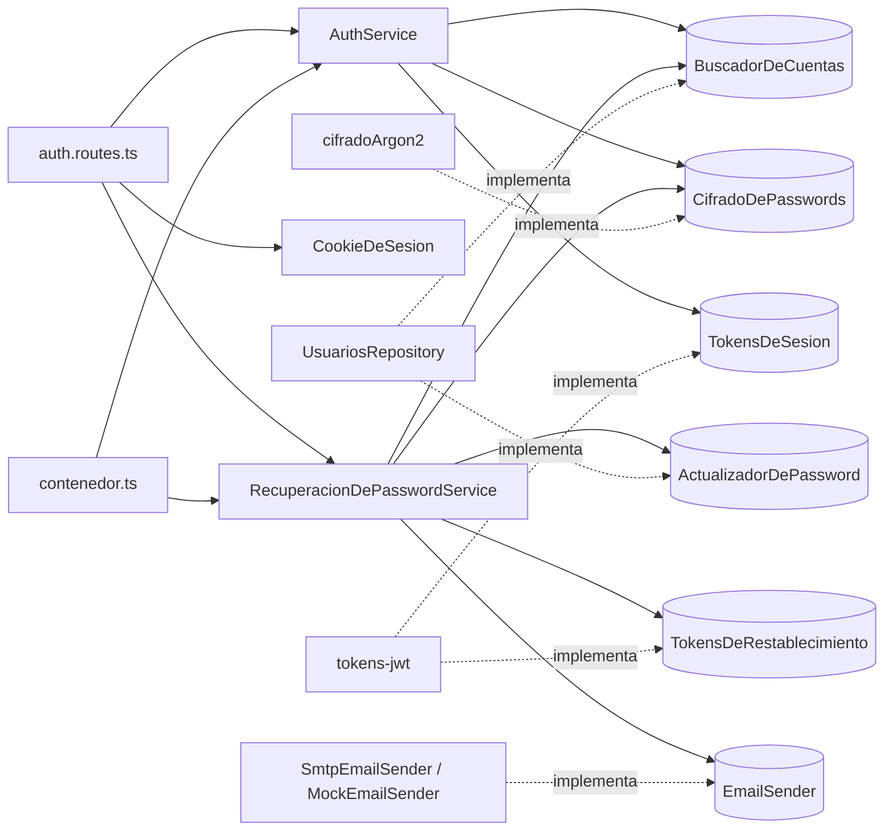
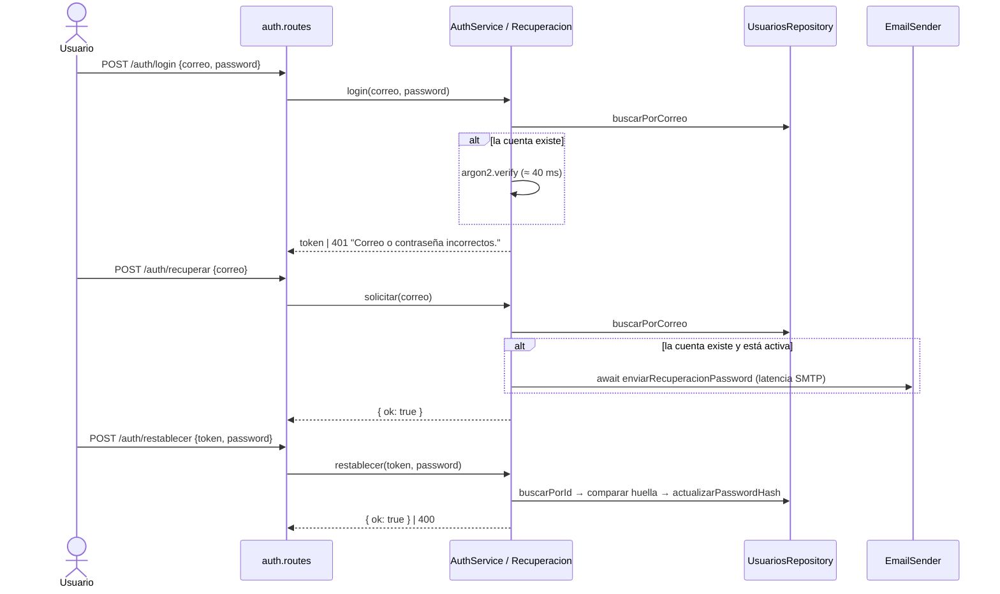
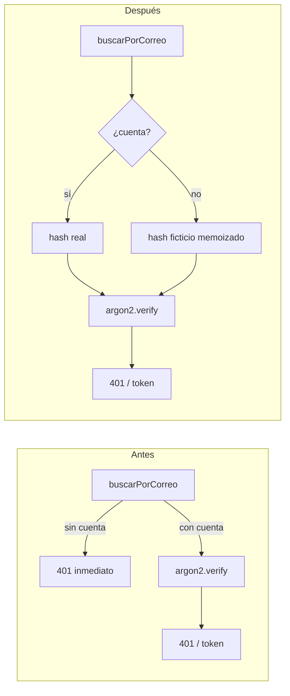

# Diagnóstico de refactorización: Autenticación y recuperación de acceso (F-01)

| Campo | Valor |
|---|---|
| Fecha | 2026-10-29 |
| Commit analizado | `cd667fc` (rama `main`) |
| Estado del documento | Diagnóstico completo · intervención H-02 **implementada y verificada** (`29d6520`) |

**Contenido:** [1. Contexto](#1-contexto) · [2. Arquitectura real](#2-arquitectura-real) · [3. Hallazgos](#3-hallazgos) · [4. Priorización](#4-priorización) · [5. Intervención](#5-intervención) · [6. Verificación](#6-verificación) · [7. Cierre](#7-cierre) · [8. Git](#8-git)

**Resumen.** Se analizó la funcionalidad de autenticación y recuperación de acceso (F-01). La arquitectura respeta la separación de capas y los principios SOLID, pero se encontraron tres defectos de lógica:

- El inicio de sesión revela por tiempo qué correos están registrados (**H-02**).
- La solicitud de recuperación también lo revela por tiempo (**H-01**).
- El enlace de restablecimiento admite dos usos simultáneos (**H-03**).

Se priorizó e implementó H-02: la diferencia de tiempo entre un correo registrado y uno inexistente bajó de **43,3 ms a menos de 8 ms**. Las pruebas existentes se conservaron y se agregó una prueba de regresión.

---

## 1. Contexto

### 1.1 Equipo y repositorio

| Campo | Valor |
|---|---|
| Equipo | Juan Esteban Soto, Vanessa Henao y Miguel Marulanda |
| Institución | Universidad del Quindío, programa de Ingeniería de Software (Ingeniería de Software II) |
| Repositorio | [rimak1/portal-tutorias-software-2](https://github.com/rimak1/portal-tutorias-software-2) |
| Fuentes | Plan de Requisitos 2026 v3, Informe de Arquitectura de Software v2.0 (octubre de 2026) y el código fuente |

### 1.2 El proyecto

El **Portal de Tutorías Académicas** reemplaza la coordinación informal de tutorías (mensajes y llamadas entre estudiantes y tutores), que no deja registro, no evita choques de horario y no permite saber cuántas tutorías se hicieron. El portal lo resuelve así:

- El **tutor** registra sus materias y publica franjas de disponibilidad.
- El **estudiante** consulta las franjas vigentes, las filtra por materia y reserva una en tres pasos.
- La reserva crea una **cita** en estado Pendiente. El tutor la aprueba, la rechaza con un motivo o propone otra franja, y el estudiante puede cancelarla.
- Cada cambio de estado queda en una **bitácora** con su actor (BR-04).

El sistema maneja poco volumen (unos 50 usuarios concurrentes), pero es exigente en **consistencia**: un tutor no puede tener franjas traslapadas y dos estudiantes no pueden reservar la misma franja. Por eso las reglas críticas se aplican en los servicios y, además, en restricciones de PostgreSQL.

**Estado.** Hay 8 de las 11 funcionalidades implementadas (F-01 a F-06, F-10 y F-11). Faltan las notificaciones (F-07), la administración de usuarios (F-08) y el histórico (F-09). Existen cuatro roles: Estudiante, Tutor, Coordinador académico y Administrador. Los dos últimos solo pueden iniciar sesión por ahora.

### 1.3 Stack tecnológico

| Capa | Tecnología | Uso |
|---|---|---|
| Lenguaje | TypeScript (modo estricto) | Frontend, backend y paquete compartido |
| API | Node.js 20 + Fastify 5 | Servidor HTTP, cookies, CORS y errores HTTP |
| Validación | Zod 3 | Esquemas en `packages/shared`, usados por la API y por la SPA |
| Datos | Prisma 5 + PostgreSQL 16 (`btree_gist`) | Consultas tipadas, migraciones y SQL directo para bloqueos y restricciones |
| Seguridad | argon2 (argon2id), jsonwebtoken | Hash de contraseñas; firma de la sesión y del enlace de restablecimiento |
| Correo | Nodemailer | Adaptador SMTP del puerto `EmailSender` (única integración externa, E-01) |
| Interfaz | React 18 + React Router 6 + Vite 5 | SPA con un panel por rol |
| Calidad | Vitest, ESLint, `tsc` | Pruebas unitarias, de integración y de rendimiento; análisis estático |
| Despliegue | Docker Compose + Nginx, GitHub Actions | Tres contenedores; CI con PostgreSQL real |

Estructura del monorepo:

```text
apps/api         API REST (módulos auth, usuarios, materias, disponibilidad, citas, email)
apps/web         SPA React
packages/shared  Esquemas Zod y tipos compartidos (contrato entre API y SPA)
docs/            Arquitectura y este diagnóstico
```

### 1.4 Funcionalidad analizada y por qué

Se analizó **F-01, *Autenticación y control de acceso por rol***, junto con el flujo de recuperación de contraseña que la acompaña en el Plan de Requisitos. La elección se justifica por tres razones:

1. **Exposición.** Es la única parte del sistema que se puede usar sin sesión, así que cualquier persona con acceso a la red la alcanza.
2. **Criticidad.** Protege todo lo demás: si la autenticación falla, falla el control de acceso por rol (RN-001) de las otras siete funcionalidades.
3. **Requisito de negocio.** Responde directamente a BR-05 (seguridad y confidencialidad), y el propio Informe de Arquitectura ya reconoce brechas abiertas en esta área (§10.3).

### 1.5 Método del diagnóstico

1. **Revisión estática** de todos los módulos de `apps/api` y de la lógica de citas de `apps/web`. Se evaluaron la separación de capas, SOLID, el acoplamiento, la cohesión, la duplicación y la ubicación de las reglas de negocio.
2. **Contraste** de cada comportamiento observado con el requisito del Plan y con lo que afirma el Informe de Arquitectura.
3. **Reproducción** de cada hallazgo seleccionado con un script que usa el código real, sin modificarlo ([evidencias/medir-linea-base.ts](evidencias/medir-linea-base.ts)).
4. **Clasificación** de cada hallazgo con estos criterios:

| Tipo | Criterio usado |
|---|---|
| Defecto | El código incumple un requisito o una garantía documentada, y se puede reproducir. |
| Riesgo | El código puede producir un fallo o una vulnerabilidad en ciertas condiciones, o falta un requisito explícito para decidir si es defecto. |
| Deuda técnica | El comportamiento es correcto, pero la estructura encarece o hace frágil el cambio (duplicación, baja cohesión). |
| Mejora | Cambio opcional sin impacto funcional ni de riesgo. |

### 1.6 Requisitos relacionados

Tomados del Plan de Requisitos 2026 v3:

| ID | Requisito | Jira |
|---|---|---|
| BR-05 | La institución debe garantizar la seguridad, confidencialidad y disponibilidad de la información de estudiantes y tutores. | — |
| SyR-01 / SWR-01 | Inicio de sesión diferenciado por rol; validar credenciales contra los usuarios registrados. | TUT-01 |
| SWR-02 | Redirigir al panel del rol una vez autenticado. | TUT-02 |
| StR-09 / SyR-12 / SWR-18 | Recuperar el acceso solicitando el restablecimiento con el correo registrado. | TUT-18 |
| StR-10 / SyR-13 / SWR-23 | Proteger la información de los usuarios; contraseñas cifradas, nunca en texto plano. | TUT-23 |

### 1.7 Compromisos de la arquitectura documentada

Estos son los compromisos del Informe de Arquitectura v2.0 que el diagnóstico contrasta con el código:

- §5.3.1: «El error de credenciales es único para correo inexistente, contraseña incorrecta y cuenta desactivada: la respuesta no revela cuál fue.»
- §5.3: el escenario de recuperación debe funcionar «sin filtrar información».
- §6.1: enlace de restablecimiento «firmado, de vida corta y de un solo uso gracias a la huella de la contraseña».

---

## 2. Arquitectura real

### 2.1 Vista general (contenedores)

El sistema es un **monolito modular** en tres contenedores. Así, cada regla que combina varias escrituras se ejecuta en una sola transacción de base de datos (ADR-01 del Informe).



### 2.2 Capas del backend y patrones aplicados

```text
rutas (Fastify)  →  servicios (casos de uso)  →  puertos (interfaces)  ←  adaptadores (Prisma, argon2, JWT, SMTP)
                                    ↑
                          contenedor.ts (raíz de composición)
```

| Patrón o principio | Dónde | Efecto en esta funcionalidad |
|---|---|---|
| Puertos y adaptadores | `auth.puertos.ts`, `usuarios.puertos.ts`, `email-sender.ts` | `AuthService` y `RecuperacionDePasswordService` no conocen Prisma, argon2 ni JWT. Gracias a eso los tres hallazgos se reprodujeron sin base de datos. |
| Inyección de dependencias con raíz de composición | `contenedor.ts` | Las pruebas sustituyen el repositorio, el cifrado o el correo sin tocar los servicios. |
| Segregación de interfaces (ISP) | `BuscadorDeCuentas`, `ActualizadorDePassword`, `ConsultaDeSesion` | Cada consumidor recibe solo lo que usa. Por ejemplo, el middleware de sesión nunca ve el hash de la contraseña. |
| Fábrica (Factory) | `email-sender.factory.ts` | Elige el adaptador de correo (`mock` o `smtp`) según `EMAIL_ADAPTER`. |
| Manejo centralizado de errores | `manejador-de-errores.ts` | Los servicios lanzan `ErrorDeNegocio` y nunca exponen detalles internos (500 genérico). |

### 2.3 Componentes que participan

| Capa | Componente | Archivo | Responsabilidad |
|---|---|---|---|
| Ruta (controlador) | `authRoutes` | [auth.routes.ts](../../apps/api/src/modules/auth/auth.routes.ts) | Valida la entrada con Zod, delega en el servicio y escribe o borra la cookie. |
| Middleware | `sessionPlugin` / `requireAuth` | [session.ts](../../apps/api/src/middleware/session.ts) | Valida la cookie y vuelve a leer el rol y el estado de la cuenta en cada petición (RN-001). |
| Middleware | `crearCookieDeSesion` | [cookie-de-sesion.ts](../../apps/api/src/middleware/cookie-de-sesion.ts) | Única definición de la cookie (HttpOnly, SameSite=Lax, Secure en producción). |
| Servicio | `AuthService.login` | [auth.service.ts](../../apps/api/src/modules/auth/auth.service.ts) | Caso de uso de inicio de sesión (SWR-01). |
| Servicio | `RecuperacionDePasswordService` | [recuperacion-password.service.ts](../../apps/api/src/modules/auth/recuperacion-password.service.ts) | `solicitar` envía el enlace (SWR-18); `restablecer` define la nueva contraseña. |
| Puertos | `CifradoDePasswords`, `TokensDeSesion`, `TokensDeRestablecimiento` | [auth.puertos.ts](../../apps/api/src/modules/auth/auth.puertos.ts) | Interfaces de las que dependen los servicios. |
| Puertos | `BuscadorDeCuentas`, `ActualizadorDePassword`, `ConsultaDeSesion` | [usuarios.puertos.ts](../../apps/api/src/modules/usuarios/usuarios.puertos.ts) | Acceso a cuentas, segregado por uso (ISP). |
| Adaptadores | `cifradoArgon2`, `crearTokensDe*` | [cifrado-argon2.ts](../../apps/api/src/modules/auth/cifrado-argon2.ts), [tokens-jwt.ts](../../apps/api/src/modules/auth/tokens-jwt.ts) | argon2id (SWR-23) y JWT firmados, sobre [lib/hash.ts](../../apps/api/src/lib/hash.ts) y [lib/token.ts](../../apps/api/src/lib/token.ts). |
| Persistencia | `UsuariosRepository` | [usuarios.repository.ts](../../apps/api/src/modules/usuarios/usuarios.repository.ts) | Único punto de acceso a la tabla `usuario`. |
| Integración | `EmailSender` (`SmtpEmailSender`, `MockEmailSender`) | [modules/email/](../../apps/api/src/modules/email/) | Envío del correo de restablecimiento (excepción E-01). |
| Composición | `crearContenedor` | [contenedor.ts](../../apps/api/src/contenedor.ts) | Único módulo que instancia las implementaciones concretas. |

### 2.4 Dependencias



La dirección de las dependencias coincide con la documentada (controlador → servicio → puerto ← adaptador), y ningún servicio importa Prisma, argon2 ni JWT. La evaluación completa de diseño está en la sección 2.7.

### 2.5 Flujo de la funcionalidad



Las ramas `alt` del diagrama son el origen de H-01 y H-02. La secuencia leer → comparar → escribir de `restablecer` es el origen de H-03.

### 2.6 Controles de seguridad vigentes

Antes de buscar fallas conviene dejar constancia de lo que ya está bien resuelto, para no proponer cambios innecesarios:

| Control | Implementación | Requisito |
|---|---|---|
| Contraseñas con hash, nunca en texto plano | argon2id (`lib/hash.ts`); un hash dañado se trata como no coincidente | SWR-23 |
| Sesión no accesible desde scripts del navegador | Cookie `HttpOnly`, `SameSite=Lax` y `Secure` en producción (`cookie-de-sesion.ts`) | BR-05 |
| Desactivar una cuenta corta el acceso de inmediato | `requireAuth` vuelve a leer el rol y el estado de la cuenta en cada petición | RN-001 |
| El mensaje de error de login es único | «Correo o contraseña incorrectos.» para los tres casos de fallo | §5.3.1 |
| El enlace de restablecimiento caduca y se invalida al cambiar la contraseña | JWT de vida corta con la huella del hash vigente (`pwfp`) | SWR-18, ADR-06 |
| Un fallo del correo no altera la respuesta | `solicitar` registra el error y responde igual | SWR-18 |
| Los errores internos no se exponen | 500 con un mensaje genérico; el detalle va solo al registro | BR-05 |

### 2.7 Evaluación de diseño

| Aspecto | Resultado | Justificación |
|---|---|---|
| Separación de capas | Correcta | Las rutas solo validan y delegan ([auth.routes.ts](../../apps/api/src/modules/auth/auth.routes.ts)). Ninguna regla de negocio vive en el controlador ni en el repositorio. |
| SRP | Sin violaciones | `AuthService` solo autentica; la recuperación está en un servicio aparte, y la cookie tiene un único punto de definición. |
| DIP | Sin violaciones | Los servicios dependen de interfaces, y solo `contenedor.ts` instancia las implementaciones concretas. |
| OCP | Sin violaciones | Para agregar un proveedor de correo basta con una entrada en `ADAPTADORES`, sin tocar el servicio. |
| Acoplamiento | Bajo | Los servicios de autenticación no dependen de otros módulos de negocio. |
| Cohesión | Alta | Cada archivo agrupa una sola responsabilidad (puertos, adaptador, servicio, ruta). |
| Duplicación | Menor | `lib/token.ts` y `tokens-jwt.ts` forman dos capas de envoltura sobre JWT. Es aceptable porque separa la función pura del adaptador del puerto. |

**Conclusión.** Los problemas encontrados **no son estructurales**. Están en la lógica interna de dos casos de uso: ramas con costo distinto según exista o no la cuenta, y una regla de unicidad sin protección ante concurrencia. Por eso las correcciones son locales y no exigen rediseñar capas ni puertos.

---

## 3. Hallazgos

Los tres hallazgos se confirmaron ejecutando el código real (argon2 y JWT reales, con los dobles en memoria de las pruebas). El script es [evidencias/medir-linea-base.ts](evidencias/medir-linea-base.ts) y su salida está en [evidencias/linea-base-antes.txt](evidencias/linea-base-antes.txt).

### H-01: Enumeración de cuentas por tiempo en la solicitud de recuperación

| Campo | Contenido |
|---|---|
| **ID / Tipo** | H-01 · **Defecto** (seguridad) |
| **Ubicación** | `apps/api/src/modules/auth/recuperacion-password.service.ts` · `RecuperacionDePasswordService.solicitar` · líneas 30-45 |
| **Evidencia** | Código y medición (ver abajo) |
| **Observación** | El cuerpo de la respuesta es idéntico (`{ ok: true }`), pero solo cuando la cuenta existe y está activa el servicio **espera** el envío SMTP antes de responder. La diferencia de tiempo revela qué correos están registrados. El JSDoc del mismo método promete que «nunca cambia su comportamiento según exista o no la cuenta», y el Informe de Arquitectura (§5.3) dice que el flujo no filtra información. |
| **Criterio** | Confidencialidad (BR-05, SyR-13). Inconsistencia entre la arquitectura documentada y la implementación. |
| **Impacto y riesgo** | Con un SMTP simulado de 300 ms: **311,6 ms** si el correo existe frente a **0,0 ms** si no existe. La lista de cuentas válidas facilita la fuerza bruta, que además no tiene límite de intentos (brecha ya reconocida en el Informe §10.3). Con `EMAIL_ADAPTER=mock` no se manifiesta; con `smtp`, la configuración de producción, sí. |
| **Acción propuesta** | Desacoplar el envío de la respuesta: lanzar `enviarRecuperacionPassword` sin `await` y con un `.catch` que registre el error. Alternativa robusta: una cola o un outbox. |
| **Verificación** | Prueba con un `EmailSender` que tarde 2 s: `solicitar` debe resolver en menos de 50 ms y el envío debe ocurrir igual. La prueba existente «un proveedor caído no hace fallar la solicitud» debe seguir pasando. |
| **Estado** | Pendiente |

```ts
// recuperacion-password.service.ts:33-44
if (!cuenta || !cuenta.activo) {
  return;                                   // ← responde de inmediato
}
const token = tokens.emitir(cuenta.id, cuenta.passwordHash);
...
try {
  await this.deps.correo.enviarRecuperacionPassword(cuenta.correo, enlace); // ← espera al SMTP
} catch (error) { ... }
```

### H-02: Enumeración de cuentas por tiempo en el inicio de sesión

| Campo | Contenido |
|---|---|
| **ID / Tipo** | H-02 · **Defecto** (seguridad) |
| **Ubicación** | `apps/api/src/modules/auth/auth.service.ts` · `AuthService.login` · líneas 21-32 (condición en la línea 24) |
| **Evidencia** | Código y medición (ver abajo) |
| **Observación** | La evaluación en cortocircuito de `!cuenta \|\| !(await verificar(...))` hace que argon2 **solo** se ejecute cuando el correo existe. El mensaje de error es único, como exige el Informe de Arquitectura §5.3.1, pero el tiempo no lo es: la respuesta delata si el correo está registrado. |
| **Criterio** | Confidencialidad (BR-05, SyR-13) en el requisito central SWR-01. Inconsistencia con §5.3.1, que solo se cumple a nivel de contenido. |
| **Impacto y riesgo** | Mediana de 20 intentos, ambos con 401: **43,3 ms** con correo registrado frente a **0,0 ms** con correo inexistente. Se manifiesta en todos los entornos, sin depender de la configuración. Es el endpoint más expuesto del sistema, lo usan los cuatro roles y no tiene límite de intentos (Informe §10.3). |
| **Acción propuesta** | Ejecutar siempre la verificación argon2. Si no hay cuenta, verificar contra un hash ficticio calculado una sola vez. Ver el diseño en la sección 5. |
| **Verificación** | (1) Las pruebas existentes de `AuthService.login` deben pasar sin cambios. (2) Prueba nueva con un `CifradoDePasswords` espía: `verificar` debe llamarse exactamente una vez también con un correo inexistente. (3) Repetir la medición: la diferencia entre los dos casos debe ser menor a la variación natural de argon2. |
| **Estado** | **Verificado** (implementado en `29d6520`; ver secciones 5 y 6) |

```ts
// auth.service.ts:22-26
const cuenta = await this.cuentas.buscarPorCorreo(correo);

if (!cuenta || !(await this.cifrado.verificar(cuenta.passwordHash, password)) || !cuenta.activo) {
  throw noAutenticado("Correo o contraseña incorrectos.");
}
```

### H-03: El enlace "de un solo uso" admite dos restablecimientos simultáneos

| Campo | Contenido |
|---|---|
| **ID / Tipo** | H-03 · **Defecto** (concurrencia) |
| **Ubicación** | `apps/api/src/modules/auth/recuperacion-password.service.ts` · `RecuperacionDePasswordService.restablecer` · líneas 53-70 |
| **Evidencia** | Código y medición (ver abajo) |
| **Observación** | La regla «un solo uso» se implementa como leer la cuenta → comparar la huella → escribir el hash nuevo, sin transacción ni escritura condicional. Dos peticiones simultáneas leen la misma huella, las dos pasan la comparación y las dos escriben; prevalece la última. La prueba existente «el enlace es de un solo uso» pasa porque ejecuta las dos llamadas **en secuencia**. |
| **Criterio** | Integridad de una regla documentada (Informe §6.1, «de un solo uso»; comentario de `TokensDeRestablecimiento`). |
| **Impacto y riesgo** | Al lanzar dos `restablecer` en paralelo con el mismo token, **2 de 2** tienen éxito (lo esperado es 1). Impacto bajo: hace falta poseer el token, que solo llega al correo del usuario. Pero la garantía declarada no se cumple. |
| **Acción propuesta** | Escritura condicional en el repositorio: `updateMany({ where: { id, passwordHash: hashLeido }, data: { passwordHash: nuevo } })`. Si actualiza 0 filas, lanzar «El enlace ya fue utilizado.». Requiere ampliar `ActualizadorDePassword` con un método que reciba el hash esperado. |
| **Verificación** | Prueba con `Promise.allSettled` de dos `restablecer` con el mismo token: exactamente uno debe cumplirse y el otro fallar con 400. Ejecutarla también contra PostgreSQL en la prueba de rutas. |
| **Estado** | Pendiente |

```ts
// recuperacion-password.service.ts:60-69
const cuenta = await cuentas.buscarPorId(datos.usuarioId);              // lectura
...
if (tokens.huellaDe(cuenta.passwordHash) !== datos.huellaDePassword) {   // comparación
  throw solicitudInvalida("El enlace ya fue utilizado.");
}
await cuentas.actualizarPasswordHash(cuenta.id, await cifrado.cifrar(nuevaPassword)); // escritura no condicional
```

---

## 4. Priorización

Escala 1 (bajo) a 3 (alto). **Prioridad = (Impacto × Riesgo) / Esfuerzo.**

| ID | Impacto | Riesgo | Esfuerzo | Prioridad | Argumento |
|---|:-:|:-:|:-:|:-:|---|
| **H-02** | 3 | 3 | 1 | **9,0** | Afecta el requisito central SWR-01 y el endpoint más expuesto. Ocurre en cualquier configuración y se explota sin herramientas especiales (43 ms frente a 0 ms). El cambio queda contenido en un método, sin tocar puertos ni base de datos. |
| H-01 | 2 | 2 | 1 | 4,0 | Mismo tipo de fuga, pero solo con `EMAIL_ADAPTER=smtp`, y el endpoint se usa con menos frecuencia. El cambio también es pequeño, aunque obliga a decidir cómo registrar los fallos de un envío asíncrono. |
| H-03 | 1 | 1 | 2 | 0,5 | Requiere poseer el token y que dos peticiones coincidan. La corrección toca el puerto, el repositorio y los dobles de prueba. |

**Razón de la selección: H-02.** Tiene el mayor impacto y el mayor riesgo con el menor esfuerzo. Además, cierra la inconsistencia más visible entre la arquitectura documentada (§5.3.1) y el código. Como su fuga se mide con un script de pocas líneas, la verificación antes/después es objetiva. H-01 sigue en la cola inmediata porque comparte la causa: la diferencia de tiempo entre la rama «la cuenta existe» y la rama «no existe».

---

## 5. Intervención

**Cambio elegido.** H-02: verificación argon2 en tiempo uniforme dentro de `AuthService.login`.

### 5.1 Diseño antes

```ts
async login(correo: string, password: string) {
  const cuenta = await this.cuentas.buscarPorCorreo(correo);

  if (!cuenta || !(await this.cifrado.verificar(cuenta.passwordHash, password)) || !cuenta.activo) {
    throw noAutenticado("Correo o contraseña incorrectos.");
  }
  ...
}
```

### 5.2 Diseño después (implementado en `29d6520`)

```ts
/** Contraseña sin dueño; su hash iguala el costo de verificar cuando el correo no existe. */
const PASSWORD_FICTICIA = "sin-cuenta-asociada";

export class AuthService {
  private hashFicticio?: Promise<string>;

  constructor(...) {}

  async login(correo: string, password: string) {
    const cuenta = await this.cuentas.buscarPorCorreo(correo);
    const hash = cuenta?.passwordHash ?? (await this.obtenerHashFicticio());
    const coincide = await this.cifrado.verificar(hash, password);

    if (!cuenta || !coincide || !cuenta.activo) {
      throw noAutenticado("Correo o contraseña incorrectos.");
    }
    ...
  }

  /** Se calcula una sola vez, con el mismo cifrado (y costo) que los hashes reales. */
  private obtenerHashFicticio(): Promise<string> {
    this.hashFicticio ??= this.cifrado.cifrar(PASSWORD_FICTICIA);
    return this.hashFicticio;
  }
}
```



**Decisiones de diseño:**

- El hash ficticio se obtiene del mismo puerto `CifradoDePasswords`, así que tiene los mismos parámetros de costo que los hashes reales y el servicio sigue sin depender de argon2 (DIP intacto).
- Se calcula una sola vez y de forma perezosa: el primer login sin cuenta paga un `cifrar` y los siguientes solo un `verificar`.
- La firma pública de `login`, el mensaje y el código 401 no cambian, por lo que rutas, frontend y contrato de la API no se tocan.

### 5.3 Justificación técnica

**Modelo de amenaza.** Un atacante sin cuenta envía peticiones a `POST /auth/login` con una lista de correos y una contraseña cualquiera, y mide el tiempo de cada respuesta. Antes del cambio, cualquier respuesta de más de ~40 ms indicaba un correo registrado. Esa lista sirve para ataques de fuerza bruta o de relleno de credenciales dirigidos solo a cuentas reales, y para suplantación por correo (phishing) dirigida a estudiantes y tutores. Esto contradice BR-05 y la garantía de §5.3.1.

**Causa raíz.** El trabajo costoso (argon2, diseñado deliberadamente para ser lento) solo se hacía en una de las dos ramas. El remedio correcto es **igualar el trabajo** de ambas ramas, no disimular la diferencia.

**Alternativas evaluadas:**

| Alternativa | Por qué se descartó o se pospuso |
|---|---|
| Retardo aleatorio en las respuestas fallidas | Con suficientes muestras, el promedio vuelve a separar los dos casos: el ruido aleatorio se cancela estadísticamente. Además, agrega latencia sin eliminar la causa. |
| Retardo fijo (por ejemplo, responder siempre a los 100 ms) | Depende de que 100 ms supere siempre el costo de argon2. Si cambia el hardware o los parámetros de argon2, la garantía se rompe sin que nadie lo note. |
| Comparación en tiempo constante (`timingSafeEqual`) | Resuelve otro problema: fugas en la comparación de bytes. La fuga aquí está en que argon2 se ejecuta o no, y `argon2.verify` ya compara en tiempo constante. |
| Limitar los intentos (rate limiting) | Es necesario (H-05), pero no reemplaza esta corrección: con un límite por IP, un atacante con varias direcciones sigue midiendo. Las dos medidas se complementan. |
| **Verificar siempre contra un hash ficticio** (elegida) | Iguala el trabajo real de ambas ramas con la misma función y los mismos parámetros. Sigue siendo correcta aunque cambie el hardware o el costo de argon2. Cumple la recomendación de la *OWASP Authentication Cheat Sheet* de que el tiempo de respuesta no dependa de si el usuario existe. |

**Costo y efectos secundarios:**

- **CPU.** Un intento con un correo inexistente ahora cuesta lo mismo que uno con un correo existente (unos 50 ms de argon2). Esto aumenta el costo de un ataque de denegación de servicio sobre `/auth/login`. Es otra razón para priorizar H-05.
- **Memoria y arranque.** El hash ficticio se calcula de forma perezosa en el primer login fallido y se reutiliza. No afecta el arranque de la API ni los logins correctos.
- **Compatibilidad.** No cambian el contrato HTTP, los mensajes, los códigos de estado, los puertos ni el esquema de la base de datos, por lo que no se requiere migración ni coordinar cambios con el frontend.

**Principios respetados.** El hash ficticio se pide al mismo puerto `CifradoDePasswords`, así que el servicio sigue sin depender de argon2 (DIP) y el cambio queda confinado en el único método responsable del inicio de sesión (SRP).

### 5.4 Archivos afectados

| Archivo | Cambio |
|---|---|
| `apps/api/src/modules/auth/auth.service.ts` | Verificación incondicional y hash ficticio memoizado (+16 / −1 líneas). |
| `apps/api/test/autenticacion.test.ts` | Prueba nueva: `verificar` se invoca también con un correo inexistente (+12 líneas). |
| `docs/refactorizacion/evidencias/linea-base-despues.txt` | Salida de la medición después del cambio. |
| `docs/refactorizacion/evidencias/pruebas-despues.txt` | Salida de las pruebas después del cambio. |

No cambian la firma de `login`, los puertos, las rutas, el frontend ni el contrato de la API.

---

## 6. Verificación

### 6.1 Pruebas ejecutadas antes del cambio

| Prueba | Resultado | Evidencia |
|---|---|---|
| `vitest run test/autenticacion.test.ts test/token.test.ts test/hash.test.ts` | **16 de 16 pasan** | [evidencias/pruebas-antes.txt](evidencias/pruebas-antes.txt) |
| Medición de H-01, H-02 y H-03 (`npx tsx docs/refactorizacion/evidencias/medir-linea-base.ts`) | Las 3 fugas o carreras se reproducen | [evidencias/linea-base-antes.txt](evidencias/linea-base-antes.txt) |

Salida de la medición antes:

```text
H-02 login (mediana de 20 intentos, ambos responden 401)
  correo registrado:   43.34 ms
  correo inexistente:  0.00 ms
H-01 /auth/recuperar con SMTP simulado de 300 ms (ambos responden { ok: true })
  correo registrado:   311.61 ms
  correo inexistente:  0.00 ms
H-03 dos restablecimientos simultáneos con el mismo token
  exitosos: 2 de 2 (lo esperado por RF-003 «un solo uso» es 1)
```

**Observación.** Las 16 pruebas existentes pasan con los tres defectos presentes. Comprueban que el **contenido** de la respuesta sea igual y que el enlace no se reutilice **en secuencia**, pero no cubren tiempo ni concurrencia.

### 6.2 Verificación después del cambio

| Criterio de aceptación | Resultado | Evidencia |
|---|---|---|
| Las 16 pruebas anteriores siguen pasando sin modificarse. | **Cumple:** 17 de 17 pasan (16 anteriores + 1 nueva) | [evidencias/pruebas-despues.txt](evidencias/pruebas-despues.txt) |
| La prueba nueva pasa con el cambio y **falla sin él**. | **Cumple.** Con el `auth.service.ts` anterior falla con `expected "verifyPassword" to be called 3 times, but got 1 times`. | Ejecución manual con el archivo de `8338ae7` |
| En la medición de H-02, la diferencia entre correo registrado e inexistente es menor a 10 ms. | **Cumple:** 3,1 ms, 1,3 ms y 7,4 ms en tres corridas (antes: 43,3 ms) | [evidencias/linea-base-despues.txt](evidencias/linea-base-despues.txt) |
| `npm run typecheck` y `npm run lint` en `apps/api` sin errores. | **Cumple** | Salida de la ejecución local |
| La suite completa de `apps/api` pasa con PostgreSQL (CI de GitHub Actions). | **Pendiente:** se verifica al subir los commits a `main` | — |

Comparación de la medición de H-02 (mediana de 20 intentos):

| | Correo registrado | Correo inexistente | Diferencia |
|---|--:|--:|--:|
| Antes (`8338ae7`) | 43,34 ms | 0,00 ms | **43,34 ms** |
| Después (`29d6520`), corrida 1 | 53,70 ms | 50,60 ms | 3,10 ms |
| Después, corrida 2 | 50,96 ms | 49,63 ms | 1,33 ms |
| Después, corrida 3 | 53,22 ms | 45,81 ms | 7,41 ms |

**Lectura de los resultados.** La rama «sin cuenta» ahora cuesta lo mismo que la rama «con cuenta», y la diferencia restante es la variación natural de argon2 entre corridas. Que el caso registrado pase de 43 ms a unos 52 ms no se debe al cambio, porque esa rama ejecuta el mismo código que antes: es variación de carga de la máquina entre sesiones de medición. H-01 y H-03 siguen igual (311 ms frente a 0 ms; 2 de 2), como se esperaba, porque no formaban parte de esta intervención.

### 6.3 Limitaciones

- **Sin base de datos local.** Docker no estaba en ejecución, así que no se corrieron las pruebas de rutas e integración que necesitan PostgreSQL (`auth.routes.test.ts`, `auth.restablecer.test.ts`, etc.). El cambio no toca rutas ni repositorios, pero esas pruebas se ejecutarán en el CI.
- **Tiempo uniforme, no constante.** El cambio iguala el trabajo de las dos ramas, pero no garantiza un tiempo constante: buscar en la base de datos un correo existente o inexistente podría tardar distinto. No se midió por la falta de base de datos local; se espera que sea despreciable frente a los ~50 ms de argon2.
- **Mediciones en proceso**, sin red ni HTTP. Muestran la diferencia del caso de uso; sobre la red la diferencia sigue existiendo, aunque con más ruido.
- **H-01 usa un SMTP simulado** (300 ms), porque el repositorio no incluye un servidor SMTP de pruebas.
- **H-03 usa un repositorio en memoria.** En PostgreSQL la carrera depende del intercalado real de las transacciones. El análisis del código muestra que tampoco hay protección allí (no hay transacción ni escritura condicional), pero no se reprodujo contra la base de datos.

---

## 7. Cierre

### 7.1 Lecciones

1. **Que el mensaje sea igual no basta para no filtrar información.** El requisito de no revelar cuentas se verificó solo por el contenido de la respuesta. El tiempo es parte del comportamiento observable y debe entrar en el criterio de verificación.
2. **Una regla de unicidad o de «un solo uso» necesita una prueba concurrente** o una garantía en la base de datos. En otras partes del sistema esto ya se hace bien (índice único parcial en citas, `EXCLUDE` en franjas, `FOR UPDATE`), pero no se aplicó al restablecimiento.
3. **La arquitectura facilitó el diagnóstico.** Los puertos permitieron reproducir los tres defectos sin base de datos y con dobles existentes. La causa no es estructural sino de lógica en los casos de uso.

### 7.2 Deuda técnica pendiente

| ID | Descripción | Tipo |
|---|---|---|
| H-01 | Enumeración por tiempo en `/auth/recuperar` (sección 3). | Defecto |
| H-03 | Doble uso concurrente del enlace de restablecimiento (sección 3). | Defecto |
| H-04 | Restablecer la contraseña o cerrar sesión no invalida las sesiones abiertas (`lib/token.ts:8-10`, el token solo lleva `sub`). Reconocido en el Informe §10.3. Para decidir si es defecto hace falta un requisito explícito. | Riesgo |
| H-05 | Sin límite de intentos en `/auth/login` y `/auth/recuperar`. Reconocido en el Informe §10.3 y en la tabla de desviaciones. | Riesgo |
| H-06 | Carrera entre `GestionDeFranjasService.crear` (fuera de transacción) y `MateriasService.reemplazarDeTutor`: puede quedar una franja vigente con una materia que ya no está en el perfil. | Riesgo |
| H-07 | Las reglas de acciones por estado de la cita están duplicadas en `apps/web/src/lib/acciones-cita.ts:30-40`, y ya divergen del backend (cancelar con propuesta pendiente). | Deuda técnica |
| H-08 | `MateriasRepository.buscarMateriaConFranjasVigentesFueraDe` consulta la tabla `disponibilidad` y repite el criterio de «franja vigente» de `FranjasRepository`. | Deuda técnica |

### 7.3 Vínculo con el proceso de desarrollo

- **Plan de Requisitos:** agregar a la columna *Verificación* de SWR-01 y SWR-18 el criterio «el tiempo de respuesta no difiere de forma medible entre un correo registrado y uno no registrado». Valorar un SWR nuevo para la limitación de intentos (H-05) bajo BR-05.
- **Jira:** registrar H-02 como tarea técnica ligada a TUT-01, y H-01 y H-03 ligadas a TUT-18, con estos criterios de aceptación.
- **Informe de Arquitectura:** cuando se implementen, actualizar §5.3.1, §6.1 y §10.3 para reflejar las garantías reales.
- **Integración continua:** la prueba nueva corre en el flujo existente (`.github/workflows/ci.yml`), lo que evita que la regresión vuelva a aparecer.

---

## 8. Git

| Etapa | Commit | Enlace |
|---|---|---|
| Base analizada | `cd667fc` | [cd667fc](https://github.com/rimak1/portal-tutorias-software-2/commit/cd667fc) |
| Diagnóstico (este documento y evidencias «antes») | `8338ae7` | [8338ae7](https://github.com/rimak1/portal-tutorias-software-2/commit/8338ae7) |
| Intervención H-02, prueba nueva y evidencias «después» | `29d6520` | [29d6520](https://github.com/rimak1/portal-tutorias-software-2/commit/29d6520) |
| Actualización de este documento con los resultados | El commit que contiene esta versión del archivo (`git log -1 -- docs/refactorizacion/DIAGNOSTICO_REFACTORIZACION.md`) | — |

Todos los commits están en la rama `main`. Los enlaces de `29d6520` en adelante funcionan una vez que se suben a GitHub (`git push`).
